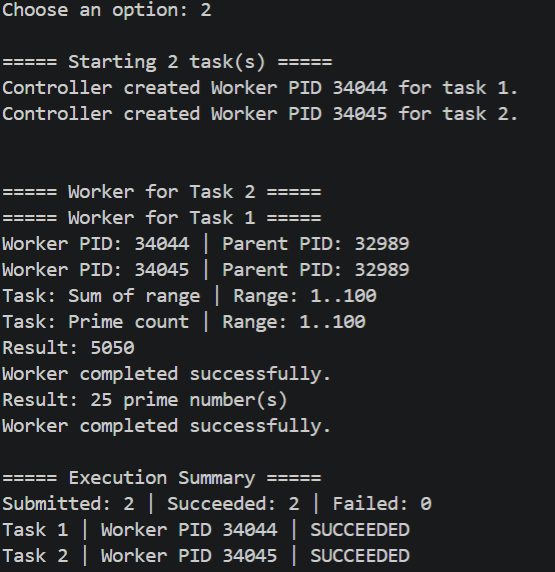
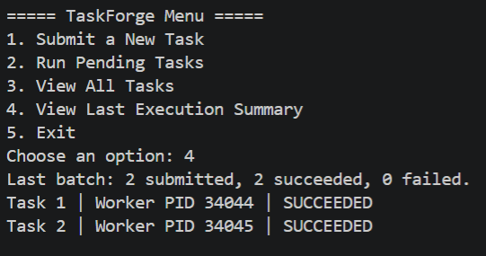
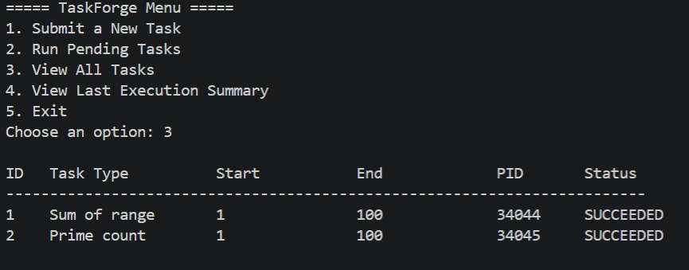

# TaskForge
### Phase 1 – Processes and System Calls

## 1. Project Overview

TaskForge is a Linux-based command-line application written in C that demonstrates process creation and management.

The application uses a **Controller** to manage user-submitted calculation tasks and separate **Worker processes** to execute them. The Controller creates Workers, monitors their execution, and collects their termination statuses.

## 2. Features

- Interactive menu for submitting and managing tasks.
- Range Sum and Prime Count calculations.
- Separate Worker process for each pending task.
- Process creation using `fork()`.
- Worker execution using `execvp()`.
- Process identification using PID and PPID.
- Process synchronization using `waitpid()`.
- Task status tracking and execution summaries.

## 3. System Architecture

TaskForge consists of two main components:

| Component | Responsibility |
|---|---|
| Controller | Manages the menu, task registry, process creation, and termination monitoring. |
| Worker | Validates task arguments, performs calculations, and prints the result. |

The Controller starts a Worker for each pending task. All Workers are started before the Controller waits for their completion, allowing multiple tasks to execute concurrently.

### Process Workflow

1. The user submits a calculation task.
2. The task is stored as `PENDING`.
3. The Controller creates a child process using `fork()`.
4. The child executes the Worker program using `execvp()`.
5. The Worker performs the assigned calculation.
6. The Controller waits for the Worker using `waitpid()`.
7. The task status is updated and the execution summary is displayed.



*The screenshot shows the Controller creating Worker processes and the Workers executing their assigned calculations.*

## 4. Linux System Calls

| System Call | Purpose |
|---|---|
| `fork()` | Creates a child process for a pending task. |
| `execvp()` | Replaces the child process image with the Worker executable. |
| `getpid()` | Returns the current process ID. |
| `getppid()` | Returns the parent process ID. |
| `waitpid()` | Waits for a specific Worker and collects its termination status. |
| `_exit()` | Terminates the child if Worker execution fails. |

## 5. Process Identification

The Controller and Workers display their process identifiers:

- **PID:** Identifies the current process.
- **PPID:** Identifies the parent process.

Each Worker is created as a child of the Controller. During normal execution, the Worker's PPID matches the Controller's PID.


*The screenshot displays Worker PIDs and their parent PID.*

## 6. Worker Execution

TaskForge supports two calculation types:

- **Range Sum:** Calculates the sum of integers within an inclusive range.
- **Prime Count:** Counts prime numbers within an inclusive range.

Each task is assigned to a Worker process. The Worker validates its arguments, performs the calculation, prints the result, and exits with an appropriate status.

The Controller records the result of each Worker's execution through its exit status.

## 7. Process Synchronization and Termination

After starting the pending Workers, the Controller waits for each process using `waitpid()`.

It checks whether a Worker:

- Exited normally.
- Returned a successful or unsuccessful exit code.
- Was terminated by a signal.

The collected status is used to update the task as `SUCCEEDED` or `FAILED`.



*The screenshot shows the final execution summary and the status of each Worker.*

## 8. Task Registry

The Controller maintains a task registry during the application session. Each task contains its ID, type, range, Worker PID, and execution status.



*The screenshot shows the registered tasks and their final statuses.*

## 9. Project Structure

```text
TaskForge/
├── src/
│   ├── main.c
│   ├── controller.c
│   ├── ui.c
│   ├── task.c
│   ├── worker_main.c
│   └── worker.c
├── include/
│   ├── task.h
│   ├── controller.h
│   ├── ui.h
│   └── worker.h
├── build/
├── screenshots/
├── Makefile
└── README.md
```

## 10. Requirements

- Linux operating system.
- GCC compiler.
- GNU Make.
- POSIX process APIs.

No third-party libraries are required.

## 11. Build and Run

Open a terminal in the TaskForge project directory.

### Build

```bash
make
```

### Run

```bash
./build/taskforge
```

## 12. Demo Instructions

1. Start TaskForge.
2. Submit a Range Sum task.
3. Submit a Prime Count task.
4. Select **Run Pending Tasks**.
5. Observe the Controller and Worker process information.
6. Review the calculation results.
7. View the task registry and execution summary.

Submitting at least two tasks before running them demonstrates the creation and management of multiple child processes.

## 13. Phase 1 Scope

This phase focuses on process creation, execution, identification, synchronization, and termination management.

Tasks are stored in memory during the application session. Workers print their calculation results directly to standard output, while the Controller collects process termination information and exit statuses.

Inter-process communication, persistent storage, and a persistent Worker Pool are outside the scope of this Phase 1 implementation.

---

**TaskForge – Operating Systems Project**  
*Phase 1: Processes and System Calls*
