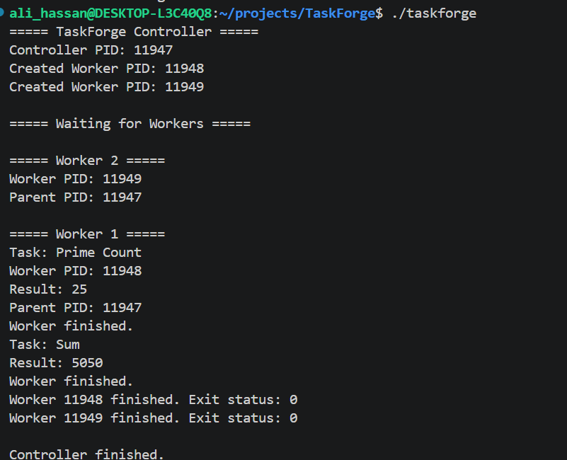

# TaskForge
### A Linux-Based Multi-Process Task Management System

## 1. Project Description

TaskForge is a Linux-based command-line application written in C. It follows a Controller–Worker architecture to manage and execute computational tasks using multiple processes.

The Controller manages and supervises the Worker processes, while each Worker is responsible for executing a specific task.

The project aims to demonstrate important Operating Systems concepts through practical implementation.

## 2. Phase 1 - Implemented Functionality

Phase 1 focuses on process creation, execution, identification, and management.

The application currently performs the following tasks:

- Creates two Worker processes using `fork()`.
- Uses `execv()` to start the Worker mode.
- Assigns a different task to each Worker.
- Calculates the sum of integers from 1 to 100.
- Counts the prime numbers from 1 to 100.
- Displays process information using `getpid()` and `getppid()`.
- Uses `waitpid()` to wait for the Workers and collect their exit status.

## 3. Process Roles

The application has one Controller process and two Worker processes.

| Process | Role |
|---|---|
| Controller | Creates and supervises the Workers and collects their exit status. |
| Worker 1 | Calculates the sum of numbers from 1 to 100. |
| Worker 2 | Counts the prime numbers from 1 to 100. |

Each Worker has a specific task, while the Controller manages their execution and termination.

## 4. System Calls Used

| System Call | Purpose |
|---|---|
| `fork()` | Creates a child process. |
| `execv()` | Starts Worker mode by replacing the child process program image. |
| `getpid()` | Gets the PID of the current process. |
| `getppid()` | Gets the PID of the parent process. |
| `waitpid()` | Waits for a specific child process and collects its termination status. |

These system calls are used as part of the application's actual workflow.

## 5. Build and Run Instructions

### Requirements

- Linux / Ubuntu
- GCC compiler

### Step 1: Open the Project Directory

Open the terminal inside the `TaskForge` directory.

### Step 2: Compile the Source Files

Run the following command:

```bash
gcc -Wall -Wextra -std=c11 -D_POSIX_C_SOURCE=200809L main.c controller.c worker.c -o taskforge
```

This creates the executable file named `taskforge`.

### Step 3: Run the Application

```bash
./taskforge
```

### Step 4: Controller Creates the Workers

The Controller starts first and uses `fork()` to create two Worker processes.

Each Worker receives its assigned task through command-line arguments.

### Step 5: Workers Execute Their Tasks

Each child uses `execv()` to start Worker mode.

- Worker 1 calculates the sum and displays the result `5050`.
- Worker 2 counts prime numbers and displays the result `25`.

Each Worker also displays its own PID and its Parent PID.

### Step 6: Wait for Process Termination

The Controller uses `waitpid()` to wait for both Workers and collect their exit status.

An exit status of `0` means that the Worker finished successfully.

## 6. Execution Screenshots

The following screenshots show the application running and demonstrate the main Phase 1 requirements.

### 6.1 Process Creation, Execution and Termination

Shows the Controller creating the Workers, their process IDs,
the results of their assigned tasks, and their exit statuses.

